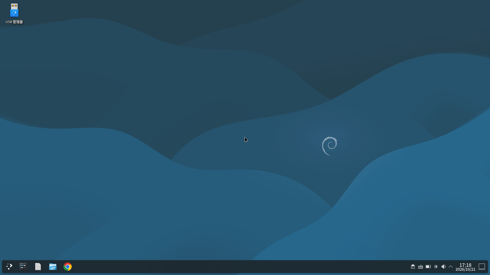

# Motorola Edge S / G100 (nio) — Droidspaces + Debian 13 KDE Plasma Wayland + Anland

最后更新：2026-10-23

这是本机实际跑通后的部署记录。日常命令统一用 **Termux + `su -c`**，
不再依赖电脑上的 `adb shell`（除非系统 UI 完全不可用，需要救砖/调试）。

> 设备：Motorola Edge S / Moto G100，代号 `nio`，SoC `sm8250`，Android 12。
> 本文不记录设备序列号、账号密码或容器镜像。



## 1. 当前状态

- 自定义 4.19.157 内核已永久刷入 `boot_a`，Magisk 30.6 root 正常。
- 内核已加入 Droidspaces 所需配置：namespace、cgroup/CFS bandwidth、seccomp、
  overlayfs、veth/bridge、macvlan、IPv6 NAT 等。
- 容器 `kde`：Debian 13 (trixie)，systemd PID 1，手动启动（`run_at_boot=0`）。
- KDE Plasma Wayland（KWin + plasmashell）可在 Anland 中显示；手机触摸可用。
- 外接 1920x1080@60 显示器直出已验证；禁用 Moto Ready For 后，Anland/KDE
  直接占满外接屏。
- 容器网络已从 NAT 改为 **host 模式**：容器与 Android 共享 `wlan0`，
  IPv4/IPv6 均正常，无 NAT66/MASQUERADE。
- Anland 外部指针捕获、无障碍按键拦截已预配置；蓝牙键鼠尚未配对实测。
- KWin 在 Anland 后端下会按帧连续合成，约 25% 单核；这是设计行为，不是泄漏。

## 2. 版本与路径

| 组件 | 版本 / 路径 |
|---|---|
| 设备 | Motorola Edge S / G100，product `nio`，Android 12 RETEU |
| 内核 | `4.19.157-perf`，2026-10-21 本地构建 |
| Magisk | 30.6（30700） |
| Droidspaces App | 7.0.0 (`com.droidspaces.app`) |
| Droidspaces CLI | `/data/local/Droidspaces/bin/droidspaces` |
| 容器 | `kde`，rootfs `/data/local/Droidspaces/Containers/kde/rootfs.img`（8 GB 稀疏 ext4） |
| rootfs | Debian 13 + KDE + 中文 + Fcitx5 + Anland 后端；上游 822 MB 镜像，见 §2.1 |
| 内核产物 | `dist/kernel/Image-4.19.157-nio-droidspaces-20261021` + AnyKernel3 zip |
| Anland App | 5.23，包名 `com.anland.consumer`（5.x 专用） |
| Anland 后端 | rootfs 内已打补丁的 KWin（`kwin_backend_anland`） |
| 外接屏 | 1920x1080@60，Android display id `4`（不同设备/线材可能不同） |

> 手机原先安装的 `com.anland.termux` 是 Anland 的 Termux 版本，**不是**
> Droidspaces 需要的消费端。Droidspaces 只认 `com.anland.consumer` 的
> `SecondaryActivity`。

### 2.1 下载与校验

内核产物在本仓库：

```text
dist/kernel/Image-4.19.157-nio-droidspaces-20261021
dist/kernel/AnyKernel3_droidspaces_nio_20261021.zip
dist/kernel/config-4.19.157-nio-droidspaces-20261021
dist/kernel/SHA256SUMS
```

`Image` 已在设备上启动验证；AnyKernel3 zip 是用同一个 `Image` 与原先已验证的
模板重新打包的。完整哈希和刷入步骤见 `dist/kernel/README.md`。

KDE 容器镜像使用上游 `Goldzxcbug/Droidspaces-rootfs-Desktop-builder` 的
Debian 13 KDE Wayland 中文版：

- 下载：
  <https://github.com/Goldzxcbug/Droidspaces-rootfs-Desktop-builder/releases/download/droidspaces-rootfs-all-wayland/Debian-13-kde-Wayland-Droidspaces-rootfs-aarch64-v20261018-063357-zh.tar.xz>
- 发布页：
  <https://github.com/Goldzxcbug/Droidspaces-rootfs-Desktop-builder/releases/tag/droidspaces-rootfs-all-wayland>
- 大小：`821,946,744` B
- SHA256：`6b92745d6f55c0b8d635046d876a33e4da59f2c70423dc2c5db845be3dd81f19`
- 本项目本地文件名：`debian13-kde-anland-zh.tar.xz`（与上游资产大小/哈希一致）

下载后先校验：

```bash
sha256sum Debian-13-kde-Wayland-Droidspaces-rootfs-aarch64-v20261018-063357-zh.tar.xz
```

> 这个 rootfs 是第三方构建产物，不是本仓库原创；许可证与来源见 `CREDITS.md`。
> 822 MB 的 tar.xz 不放进 Git 仓库。

## 3. 前置条件与风险

- 解锁 bootloader、Magisk/APatch/KernelSU 之一提供 root。
- 自定义内核必须包含 Droidspaces 要求；原厂内核通常缺少 namespace/cgroup。
- 容器 rootfs 需要从 §2.1 的上游 Release 下载后导入；822 MB 镜像不放进仓库。
- 内核可直接使用 `dist/kernel/` 的 Image/AnyKernel3，或按 `build/kernel/` 自行构建。
- 刷 `boot` 分区有变砖风险。至少保留：
  - 原厂 Magisk-patched boot；
  - 上一版可用自定义内核 boot；
  - `fastboot` 可用。
- 本项目的 host 网络模式会把容器 SSH 暴露到局域网；见 §8。

## 4. 仓库结构

```text
.
├── README.md
├── NOTES.zh-CN.md
├── CREDITS.md
├── LICENSE
├── config/
│   ├── container.config.host.example
│   └── anland_settings.xml
├── scripts/
│   ├── host/               # Android 宿主侧，Termux 运行
│   ├── container/          # 容器内 KWin 诊断
│   ├── archive/nat-mode/   # 旧 NAT 配置，仅历史参考
│   └── README.md
├── build/kernel/           # 内核配置、构建与刷入脚本
├── dist/kernel/            # 编译好的 Image / AnyKernel3 / config / 哈希
├── termux/install.sh
└── screenshots/
```

## 5. 内核

### 5.1 配置

- 基础：`nio_defconfig`
- 片段：`build/kernel/droidspaces.config`
- 构建后实际新增（`build/kernel/resolved-config-diff.txt`）：

```text
CONFIG_CFS_BANDWIDTH=y
CONFIG_MACVLAN=y
CONFIG_NF_NAT_IPV6=y
CONFIG_IP6_NF_NAT=y
CONFIG_IP6_NF_TARGET_MASQUERADE=y
CONFIG_NF_TABLES_IPV6=y
CONFIG_NFT_CHAIN_NAT_IPV6=y
CONFIG_NFT_MASQ_IPV6=y
CONFIG_NFT_MASQ=y
```

`CONFIG_USER_NS=y` 也已打开（Docker/Flatpak 等可选功能）。4.19 上不存在
的符号会被 `olddefconfig` 丢弃，不影响构建。

### 5.2 构建环境

- Debian 13 x86_64 VM，7.7 GB 内存 / 4 vCPU。
- clang 10.0.9（Snapdragon-LLVM）。
- LineageOS GCC 4.9 aarch64/arm binutils。
- 内核源码 `Aessd/kernel_motorola_sm8250`，分支 `erofs`。

具体命令见 `build/kernel/README.md`。本次编译产物放在 `dist/kernel/`：
原始 `Image`、AnyKernel3 zip 和实际 `.config`。仓库不包含带 Magisk ramdisk
的 `boot.img`。

### 5.3 刷入流程

如果不想自己编译，直接使用 `dist/kernel/`：

- `AnyKernel3_droidspaces_nio_20261021.zip`：用支持 AnyKernel3 的 kernel flasher 刷入；
- `Image-4.19.157-nio-droidspaces-20261021`：自己用 `prepare_new_boot.sh` 重打包；
- 刷前核对 `dist/kernel/SHA256SUMS`，并备份当前 `boot_a`。

自行编译时：

1. 用 Magisk 修补原厂 boot，确认能开机并拿到 root。
2. 用 `magiskboot unpack` 解包当前 Magisk boot。
3. 用新 `Image` 替换 `kernel`，`magiskboot repack`。
4. `fastboot boot new_boot.img` 临时验证：
   - 能开机；
   - WiFi、触控、Magisk 正常；
   - `droidspaces check` 通过。
5. 验证后再 `fastboot flash boot_a new_boot.img` 永久写入。

> 不要把别人设备的 boot 镜像直接刷到自己的机器上；即使同为 `nio`，
> 固件版本和 slot 也可能不同。

## 6. 容器与桌面

### 6.1 容器配置

示例见 `config/container.config.host.example`。当前关键项：

```ini
net_mode=host
disable_ipv6=0
enable_gpu_mode=1
enable_hw_access=0
enable_anland=1
run_at_boot=0
```

`run_at_boot=0` 表示开机不自动启动；用 Droidspaces App 或命令行手动启动。

rootfs 从 §2.1 的 GitHub Release 下载 `Debian-13-kde-Wayland...zh.tar.xz`，
在 Droidspaces 里创建容器时导入；先核对 SHA256，再展开为 8 GB 稀疏 ext4
镜像。导入后把 `config/container.config.host.example` 的内容按需合并到
`/data/local/Droidspaces/Containers/kde/container.config`。

### 6.2 桌面服务

rootfs 内的 `desktop-session.service` 已 enabled，以用户 `Gold`（uid 1000）
运行 `startplasma-wayland`。容器启动后等待 10–20 秒再拉起 Anland。

Anland 在容器内注入的环境变量：

```text
ANLAND=1
ANLAND_SOCKET=/run/display.sock
ANLAND_DRM_DEVICE=/dev/dri/renderD128
GALLIUM_DRIVER=kgsl
MESA_LOADER_DRIVER_OVERRIDE=kgsl
FD_FORCE_KGSL=1
WAYLAND_DISPLAY=wayland-0
```

宿主侧 broker socket：`/data/local/Droidspaces/Net/anland-<hash>.sock`
（每次启动容器 hash 会变）。日志：
`/data/local/Droidspaces/Logs/kde/anland`。

### 6.3 启动/停止

在 Termux 中：

```bash
# 查看容器
su -c "/data/local/Droidspaces/bin/droidspaces show"

# 启动 / 停止
su -c "/data/local/Droidspaces/bin/droidspaces start --name=kde"
su -c "/data/local/Droidspaces/bin/droidspaces stop --name=kde"

# 容器内桌面服务状态
su -c "/data/local/Droidspaces/bin/droidspaces --name=kde run -- systemctl status desktop-session --no-pager"
```

也可以直接用脚本：

```bash
su -c "sh /data/local/tmp/moto-nio/status_now.sh"
su -c "sh /data/local/tmp/moto-nio/restart_test.sh"
```

## 7. 显示输出

### 7.1 手机内屏

```bash
# 方式 A：Droidspaces App → 面板 → 容器 kde → Anland 按钮

# 方式 B：Termux，默认 display 0
su -c "sh /data/local/tmp/moto-nio/anland_launch.sh 0"
```

Anland 全屏时会接管底部手势区，从底部上滑不一定能回 Android 桌面。
回到桌面可以用：

```bash
su -c "input keyevent 3"
```

### 7.2 外接屏直出

先接好 USB-C / HDMI 显示器，然后：

```bash
su -c "sh /data/local/tmp/moto-nio/anland_external.sh"
```

脚本会：

1. 从 `dumpsys display` 查找 HDMI display id；
2. 容器没运行则启动 `kde`；
3. 等待 `/data/local/Droidspaces/Net/anland-*.sock`；
4. 禁用三个 Moto Ready For 包；
5. `am start ... --display <id>` 启动 Anland。

预期：KDE 直接占满 1920x1080，KWin 输出 `anland-1`，Anland 日志显示
`screen info 1920x1080`；手机内屏仍保持 Android UI。

### 7.3 切回 Ready For

```bash
su -c "sh /data/local/tmp/moto-nio/desk_on.sh"
```

然后重新插拔显示器。注意：

- `desk_on.sh` 会用 `pm enable` 恢复三个包；
- 如果之前用 Hail 等工具冻结过 `com.motorola.mobiledesktop` /
  `.core`，需要先在 Hail 里解冻；
- 直出模式下没有手机触摸板；要操作外接屏 KDE，需要 USB/蓝牙键鼠，
  或支持触摸的显示器。

### 7.4 “有桌面没任务栏”是什么

外接屏在 Anland 启动前可能先显示：

```text
com.motorola.launcher3/com.android.launcher3.secondarydisplay.SecondaryDisplayLauncher
```

它是 Moto 启动器的 `SECONDARY_HOME`，不是 Ready For。三个 Ready For 包
禁用后，它仍可能作为副屏 Home 出现。

如果只想消掉插屏时的 Launcher，可以只禁用这个 Activity：

```bash
su -c "pm disable-user --user 0 com.motorola.launcher3/com.android.launcher3.secondarydisplay.SecondaryDisplayLauncher"
```

恢复：

```bash
su -c "pm enable com.motorola.launcher3/com.android.launcher3.secondarydisplay.SecondaryDisplayLauncher"
```

手机主屏 Launcher 不受影响，但 Anland 启动前外接屏可能是黑的。

## 8. 网络（host 模式）

当前配置：

```ini
net_mode=host
disable_ipv6=0
```

host 模式下容器与 Android 共享网络命名空间，直接看到手机的 `wlan0`：

```text
wlan0  UP  192.168.x.x/24  2408:.../64  fe80::.../64
```

没有 `eth0`，也没有 NAT66 的 `MASQUERADE`。`ip -6 route` 主表为空是
Android 策略路由的正常现象；用 `ip -6 route show table all` 查看完整表。

验证：

```bash
# 容器直接看到 wlan0
su -c "/data/local/Droidspaces/bin/droidspaces --name=kde run -- ip -br addr"

# IPv6 出口
su -c "/data/local/Droidspaces/bin/droidspaces --name=kde run -- curl -6 -sS -o /dev/null -w '%{http_code}\n' --max-time 15 https://www.cloudflare.com"

# 宿主侧：不应有 NAT66 MASQUERADE
su -c "ip6tables -t nat -S"
su -c "sysctl net.ipv6.conf.all.forwarding"
```

预期 `curl -6` 返回 `200`，`ip6tables` 的 NAT 表为空或没有本项目相关规则。
`net.ipv6.conf.all.forwarding=0` 在 host 模式下是正常的，因为不需要转发/NAT。

### 8.1 旧 NAT 配置

`scripts/archive/nat-mode/` 保留了旧的静态 ULA 方案（`fd64:7370::2/64`、
网关 `fd64:7370::1`、`10-eth-dhcp.network`）。它只适用于 `net_mode=nat`。
host 模式下不要运行；如果切回 NAT，需要重新确认前缀/网关并验证。

容器内 `systemd-networkd` 目前仍是 enabled，但 `10-eth-dhcp.network` 只匹配
`eth*`，host 模式下没有 `eth0`，所以不生效。若确定不再切回 NAT，可以删除该
文件或禁用 `systemd-networkd`，避免以后插 USB 网卡时意外匹配。

### 8.2 SSH 暴露

host 模式下，如果容器启用了 `sshd`，22 端口会直接暴露在局域网。建议：

- 使用 SSH key，关闭密码登录；
- 或只允许特定来源地址；
- 或在不需要时停止容器内的 `ssh.service`。

## 9. 外接键鼠

Anland 会把 Android 收到的按键/指针事件转发给 Wayland，**不需要**把
`/dev/input` 暴露进容器。

已预置：

- `pointer_capture=true`：鼠标/触摸板相对移动，锁定在 Anland 窗口内；
- `accessibility_key_intercept=true`：拦截 F1–F12、Fn、Esc 等按键；
- 已启用无障碍服务 `com.anland.consumer/.KeyInterceptor`。

重新应用配置：

```bash
su -c "sh /data/local/tmp/moto-nio/anland_bt_input_setup.sh"
```

检查：

```bash
su -c "sh /data/local/tmp/moto-nio/check_bt_input.sh"
```

使用步骤：

1. 在 Android 设置 → 蓝牙中配对键鼠（或通过扩展坞接 USB 键鼠）；
2. 接上外接屏，运行 `anland_external.sh`；
3. 鼠标应直接可用；按 Android Back 会释放指针捕获，再点击桌面重新捕获。

如果按键到不了 Linux：

- 确认 设置 → 无障碍 → **Anland KeyInterceptor** 已开启；
- 或在 Anland 设置 → 沉浸模式中启用 **Anland takes the devices (direct)**，
  并绑定一个物理键用于进出。

> 设置里的 Gold 相关选项需要 Gold Keyboard Remaps 模块；当前未安装。
> 蓝牙键鼠若被 Android 快捷键/手势截获，优先改用沉浸模式。

## 10. 性能：KWin 为什么一直占 CPU

### 10.1 实测

外接 1920x1080@60、Anland 独占显示时，用 `/proc` 做 10 秒采样：

| 进程 | 单核占用 |
|---|---:|
| `kwin_wayland` | 25% |
| `surfaceflinger` | 20% |
| `com.android.systemui` | 13% |
| `systemui_readyfor1` | 6% |
| `com.anland.consumer` | 6% |
| 整机总 CPU | 16%（8 核） |

容器里的 `htop` 显示 25% 是按“单核 100%”算的；换算到 8 核整机约 3%。
这不是一个核心被跑满。

### 10.2 排除项

- 卸载 `blur` / `contrast` 后 CPU 仍约 24%；
- `showDesktop` 隐藏所有窗口后仍约 24%；
- KWin 使用 `freedreno / FD650 / Mesa 26.3`，不是 llvmpipe；
- 输出 1920x1080@60，Scale 1。

### 10.3 原因

Anland 的 KWin 后端是“按 consumer 节奏连续合成”：

- `anland_backend.cpp` 收到 `ANLAND_SCENE_EVENT_PRESENTED` 后调用
  `AnlandOutput::onFramePresented()`；
- `anland_output.cpp` 的 `onFramePresented()` → `onConsumerReady()`，
  后者每帧调用 `m_renderLoop->scheduleRepaint()`。

源码位置：
<https://github.com/superturtlee/anland/blob/legacy/producers/kde/anland_backend/src/backends/anland/anland_output.cpp>

1080p60 下 25% 单核约等于每帧 4 ms CPU，属于这个后端的正常成本。

### 10.4 想再降负载

1. **降低逻辑分辨率**（最实际）：
   Anland 设置 → Display Resolution → `720p` 或 `Screen × 0.75`，
   然后重新连接。720p 像素量约为 1080p 的 44%，KWin 可能降到约 11–13%
   单核；画面会由 Anland 放大到 1080p，文字略软。
2. 接受现状：整机 16% CPU，KWin 约 3% 总占用。
3. 改用更轻的合成器（Weston 等），但会失去 KDE。
4. 修改 Anland KWin 后端为 damage-driven repaint：需要改代码和验证
   frame callback/tearing，不是现成设置。

### 10.5 `systemui_readyfor1`

`com.android.systemui:systemui_readyfor1` 是 `com.android.systemui` 的副屏
SystemUI 进程，不是可单独冻结的 Ready For 包。实测 `kill -9` 后会自动重生，
所以不要用杀进程的方式“优化”；它通常占 6–8% 单核。

## 11. 已验证

- [x] 自定义内核可启动，WiFi、触控、Magisk、模块正常
- [x] `droidspaces check`：namespace、cgroup、devtmpfs、overlayfs 等通过
- [x] 容器启动、systemd、DNS
- [x] KWin Anland 后端连接 broker（`producer connected`）
- [x] Anland 显示 KDE，手机触摸可用
- [x] 容器 stop/start 后桌面恢复
- [x] 外接屏直出：display id 4，1920x1080@60，KDE 占满
- [x] Ready For 三个包可禁用/恢复
- [x] host 模式 IPv4/IPv6：`curl -6` 返回 200，无 NAT66
- [x] KDE 自动锁屏、AC 息屏/挂起已关闭
- [x] KWin CPU 归因：连续合成，非特效/泄漏
- [x] Anland 输入预配置（待蓝牙键鼠实测）
- [x] 2026-10-21 编译的 Image 已在设备上启动
- [x] rootfs 与上游 822 MB 资产的大小/SHA256 一致

## 12. 已知限制 / 待办

- [ ] 蓝牙键鼠尚未配对，鼠标相对移动、点击、滚轮、F1–F12/Esc 未实测
- [ ] 未实现插屏自动启动容器/Anland（当前手动运行）
- [ ] AnyKernel3 zip 由已验证的 Image 重打包，zip 外壳未再次实机刷入
- [ ] 822 MB rootfs、带 Magisk ramdisk 的 boot 镜像、APK 不随仓库发布；
      内核 Image/AnyKernel3 在 `dist/kernel/`
- [ ] host 模式下 SSH 22 暴露 LAN，需自行加固
- [ ] `systemui_readyfor1` 无法简单移除
- [ ] Anland 5.x 与 6.x consumer 不兼容
- [ ] 内屏 1080x2520 竖屏按 1:1 渲染；需要更舒适可调 KWin 缩放/旋转

## 13. 故障排查

| 现象 | 原因 / 处理 |
|---|---|
| Anland 提示 `Socket Not Found` | 容器未运行或 socket 已变；用 App 的 Anland 按钮或 `anland_launch.sh` 重新连接 |
| 黑屏只有鼠标指针 | Plasma 还在启动；等 10–20 秒，或检查 `plasmashell` |
| `kwin_backend_anland: consumer disconnected, entering fallback` | 正常：Anland 退到后台时 KWin 进入 fallback，重新打开恢复 |
| 桌面卡死 | `su -c "/data/local/Droidspaces/bin/droidspaces stop --name=kde"`，再 start |
| 外接屏只有 Ready For | Ready For 抢屏；运行 `anland_external.sh` |
| 禁用 desk 后黑屏/没输入 | 直出模式没有手机触摸板；接 USB/蓝牙键鼠，或 `desk_on.sh` 切回 |
| 容器无 IPv6 | host 模式先看 `ip -6 addr` 是否有 `wlan0` 地址；NAT 模式看 `disable_ipv6=0` 和 networkd |
| 蓝牙鼠标能动但点不到 / 指针出屏 | 开启 Anland“捕获外部指针”；按 Back 释放后点击桌面重新捕获 |
| 蓝牙键盘功能键无效 | 设置 → 无障碍 → 开启 Anland KeyInterceptor；仍无效用沉浸模式 |
| KDE 一段时间后锁屏 | 检查 `~/.config/kscreenlockerrc` 的 `Autolock=false`；容器内 `loginctl unlock-sessions` |
| `systemctl --failed` 显示 `systemd-udevd-*.socket` | 容器内没有 udev，属预期，不影响桌面/网络 |
| KWin 持续 25% 单核 | Anland 后端连续合成，正常；降分辨率或接受 |
| `systemui_readyfor1` 杀不掉 | 会自动重生；不要反复 kill |

> 如果 Termux 和 Android UI 都不可用，仍可用电脑上的 `adb` + root shell 做救砖。
> 日常操作不需要 adb。

## 14. 脚本索引

见 `scripts/README.md`。常用：

```bash
su -c "sh /data/local/tmp/moto-nio/anland_external.sh"
su -c "sh /data/local/tmp/moto-nio/anland_launch.sh 0"
su -c "sh /data/local/tmp/moto-nio/desk_on.sh"
su -c "sh /data/local/tmp/moto-nio/status_now.sh"
su -c "sh /data/local/tmp/moto-nio/measure_host_cpu.sh"
su -c "sh /data/local/tmp/moto-nio/check_readyfor.sh"
su -c "sh /data/local/tmp/moto-nio/check_bt_input.sh"
```

容器内诊断（从 Termux）：

```bash
scp scripts/container/diag_kwin.sh Gold@<手机IP>:/tmp/
ssh Gold@<手机IP> 'bash /tmp/diag_kwin.sh'
```

或：

```bash
su -c "/data/local/Droidspaces/bin/droidspaces --name=kde --stdin run bash -s < $PWD/scripts/container/diag_kwin.sh"
```

## 15. 第三方与许可

本项目依赖/参考的上游项目包括 Droidspaces、Anland、Debian、KDE、Mesa、
Linux kernel、AnyKernel3、Magisk、Snapdragon-LLVM、LineageOS GCC、Termux 等。
KDE rootfs 来自 `Goldzxcbug/Droidspaces-rootfs-Desktop-builder`。
完整列表、链接和许可证见 **[CREDITS.md](CREDITS.md)**。

本仓库原创的脚本、文档和配置示例采用 MIT License；第三方内容仍归原作者。
Motorola、Moto Edge S、Moto G100、Ready For 是其权利人的商标，本项目与
Motorola 无隶属关系。
